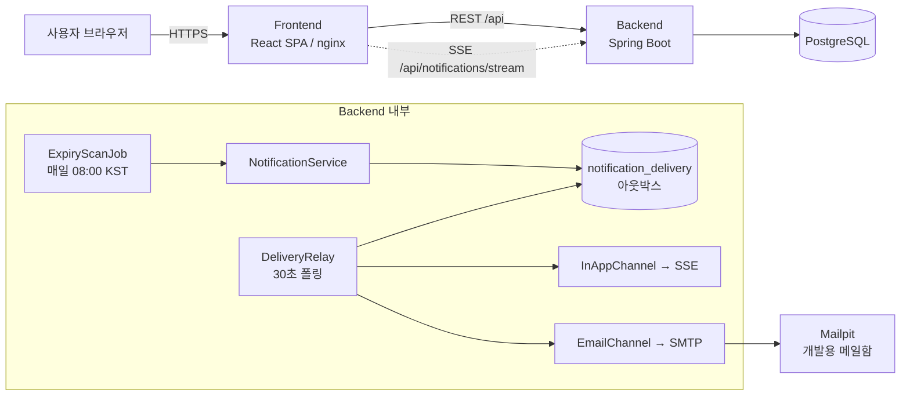
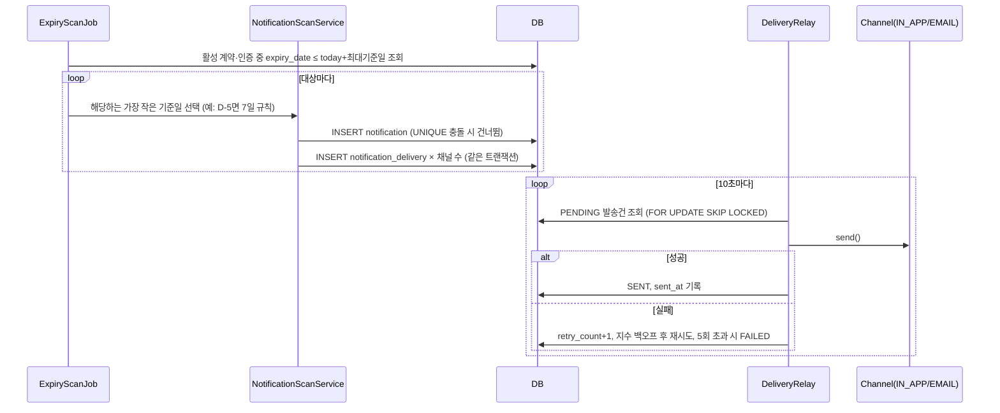
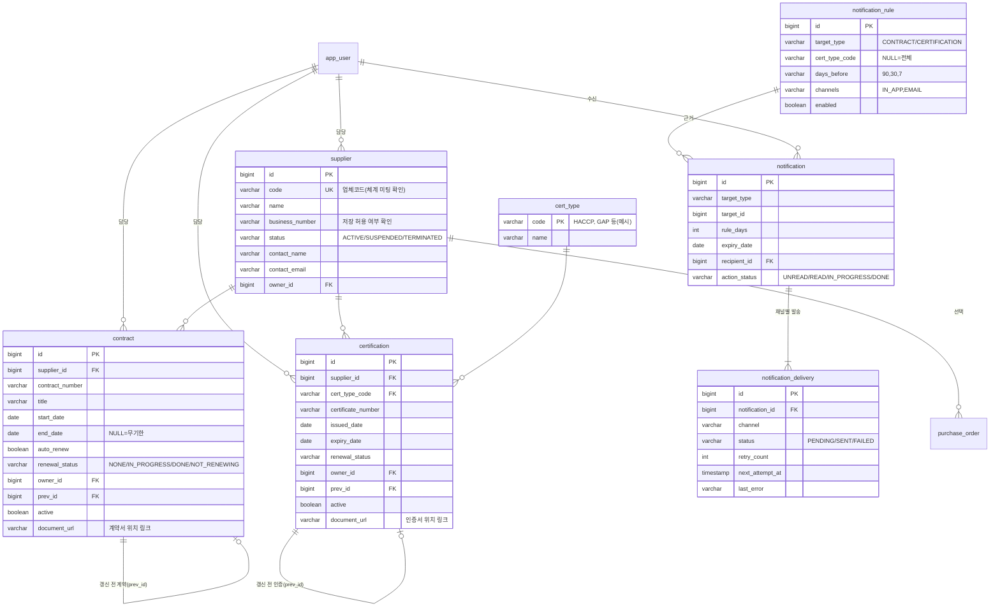

# 협력업체 통합관리 샘플 프로토타입 설계

- 작성자: JinsuBae2
- 최종 수정일: 2026-09-29
- 상태: 초안
- 구현: [ync-capstone-desgin/prototype-JinsuBae2](https://github.com/ync-capstone-desgin/prototype-JinsuBae2) — 1~4단계 구현 완료, 실제 구현과 달라진 점은 [11장](#11-구현-결과와-설계-변경-사항)에 정리

[proposal.md](proposal.md)의 기능 요구사항(FR)과 검증 시나리오(VT), [technical-design.md](technical-design.md)의 논리 구조·데이터 모델을 기준으로 **실제로 실행 가능한 샘플 프로토타입**의 기술 스택, 구조, 화면, API를 구체화한다. 기업 미팅 전이므로 `미팅 확인 필요` 항목은 가설로 두고, 바뀌어도 영향이 작도록 경계를 나눈다.

## 1. 프로토타입 목표와 범위

| 구분 | 내용 |
|---|---|
| 목표 | 첫 기업 미팅·설계 검토(M2)에서 "화면을 보며" 요구사항을 확인할 수 있는 동작 가능한 샘플 |
| 포함 | FR-001~FR-011 (Must 전체 + 알림 이력), FR-012 문서 링크, FR-013 역할 3종 최소 구현 |
| 선택 | FR-014 엑셀 일괄 등록, FR-015 발주·납기 조회 (시간이 남으면 조회 화면만) |
| 제외 | FR-016 ERP 연동, FR-017 전자계약, 문자·메신저 알림 |
| 데이터 | 비식별 샘플 데이터만 사용 (업체 20·계약 30·인증 30·사용자 3) |

## 2. 기술 스택 결정

### 2.1 요약

| 영역 | 선택 | 이유 |
|---|---|---|
| 백엔드 | Java 21, Spring Boot 4.1, Gradle | 요청 스택. LTS Java, 착수 시점 최신 안정판 |
| 영속성 | Spring Data JPA + JPQL, Flyway | 검색 조건은 JPQL로 충분하고 QueryDSL은 Boot 4 호환이 불안정해 제외. 스키마 변경 이력 관리 |
| API 문서 | springdoc-openapi (Swagger UI) | 프론트·백 병렬 개발 시 계약 기준 |
| 인증 | Spring Security 세션 로그인 | PoC에 JWT는 과함. 역할 3종(ADMIN/MANAGER/VIEWER) |
| 배치 | Spring `@Scheduled` | 1일 1회 만료 점검, 10초 주기 발송기. 서버를 여러 대로 늘리면 ShedLock 추가 |
| 프론트엔드 | React 19 + TypeScript + Vite | 다중 탭·그리드·실시간 배지 등 ERP형 화면에 SPA가 적합 |
| UI 키트 | Ant Design 6 (ko_KR 로케일) | 폼·레이아웃·날짜 선택 등 업무용 컴포넌트가 풍부 |
| 그리드 | AG Grid Community 36 | 컬럼 고정·정렬·필터·많은 행 처리 등 ERP 그리드 사용감 |
| 서버 상태 | TanStack Query | 목록 캐시·재조회 표준화 |
| 엑셀 | 서버 Apache POI 다운로드 | AG Grid Excel 내보내기는 유료(Enterprise)이므로 서버에서 생성 |
| DB | PostgreSQL 16 (PoC 기본) | 아래 2.2 참고 |
| 메일(개발) | Mailpit (로컬 SMTP 수신함) | 실제 발송 없이 이메일 알림 시연 |
| 실행 환경 | Docker Compose | `postgres + mailpit`을 띄우고 백엔드(`gradlew bootRun`)·프론트(`npm run dev`)는 로컬 실행. 전체 컨테이너화는 후속 과제 |

### 2.2 데이터베이스: "자사 시스템에 맞는" 선택

한국농산이 쓰는 ERP·DB는 아직 모른다(`미팅 확인 필요`, 질문 21·26). 국내 중견기업 ERP는 제품별로 기반 DB가 다르다.

| 한국농산 환경(가설) | 권장 DB | 비고 |
|---|---|---|
| 더존·영림원 등 국산 ERP 사용 | MS SQL Server | 해당 ERP들이 주로 MSSQL 기반. 향후 연동·운영팀 친숙도 유리 |
| Oracle 기반 사내 시스템 | Oracle | 라이선스·계정 협조 필요 |
| 별도 시스템 없음 / 클라우드 허용 | PostgreSQL | 무료, Docker로 즉시 기동, 기능 충분 |

**결정: 프로토타입은 PostgreSQL로 개발하되 DB 교체 비용을 최소화한다.**

- JPA + 표준 SQL 위주로 작성하고 DB 전용 함수(`jsonb`, 배열 타입 등)는 쓰지 않는다.
- Flyway 마이그레이션은 표준 SQL로 작성해 `db/migration` 한 곳에 둔다. DB가 바뀌어 차이가 생기면 그때 `db/migration/{vendor}`로 나눈다.
- 날짜는 `DATE`(만료일)와 `TIMESTAMP`(생성·발송일시)만 사용, 시간대는 앱에서 `Asia/Seoul` 고정.
- 미팅에서 MSSQL로 확정되면 드라이버·방언·벤더 마이그레이션만 교체한다. 테스트는 Testcontainers로 실제 DB 대상 실행.

### 2.3 알림 인프라: SQS·Kafka가 필요한가?

**결론: 프로토타입에는 필요 없다. 대신 나중에 끼울 수 있게 경계만 만든다.**

| 판단 기준 | 이 프로젝트 | Kafka/SQS가 필요한 수준 |
|---|---|---|
| 알림 발생량 | 하루 수~수십 건 (업체 수백 곳 가정) | 초당 수백 건 이상 |
| 발생 시점 | 1일 1회 배치 | 실시간 이벤트 스트림 |
| 소비자 | 앱 하나 (화면·메일) | 여러 시스템이 같은 이벤트 구독 |
| 운영 부담 | 3인 학생팀, 12주 | 브로커 운영 인력 |

Kafka는 운영 부담 대비 이득이 없고, SQS는 AWS 배포가 확정돼야 의미가 있다. 대신 **트랜잭셔널 아웃박스(Outbox) 패턴**을 DB 테이블로 구현해 메시지 큐가 주는 핵심 이점(업무 저장과 발송 분리, 재시도, 중복 방지, 실패 기록)을 얻는다. 이는 technical-design.md 8장 "알림 발송 실패와 업무 데이터 저장 실패를 분리해 기록한다"를 그대로 만족한다.

확장 경로:

```text
[지금]  NotificationService → notification_delivery(아웃박스 테이블) → DbPollingRelay → Channel(IN_APP, EMAIL)
[AWS]   ... → notification_delivery → SqsRelay → SQS(+DLQ) → 발송 워커        ← 배포가 AWS로 확정되면
[연동]  ... → notification_delivery → KafkaRelay → Kafka 토픽 → ERP·그룹웨어 등 다수 소비자  ← 여러 시스템 연동 시
```

`DeliveryRelay` 인터페이스 하나만 교체(Spring 프로파일)하면 되도록 설계한다.

## 3. 시스템 구성



## 4. 백엔드 설계

### 4.1 패키지 구조 (기능 단위)

```text
com.hankooknongsan.supplier
├─ common/          공통 응답·예외(ProblemDetail)·감사 컬럼·기준 시계(AppClock)·만료 판정(ExpiryPolicy)·코드값
├─ auth/            로그인, 사용자, 역할
├─ supplier/        협력업체 (FR-001~004)
├─ contract/        계약 (FR-005)
├─ certification/   인증, 인증 종류 코드 (FR-006)
├─ expiry/          만료 예정 목록 조회 (FR-008)
├─ dashboard/       요약 집계 (FR-009)
├─ notification/    알림·발송 기록·알림함 (FR-010, FR-011)
│   ├─ rule/        알림 기준 설정
│   ├─ job/         만료 점검(알림 생성)·정기 작업
│   ├─ delivery/    아웃박스 발송기(DeliveryRelay)
│   └─ channel/     화면(SSE)·이메일 채널
└─ dev/             dev 프로파일 전용: 샘플 데이터, 기준일 변경, 즉시 점검
```

- 각 기능은 `controller → service → repository` 3계층이다.
- 참조 방향은 `expiry·dashboard·notification → contract·certification → supplier → auth·common`으로 한쪽만 둔다.
- 만료 판정(`ExpiryPolicy`)은 계약·인증 목록에서도 D-day를 보여줘야 해서 `common`에 둔다.
- 계약·인증이 갱신되면 알림을 닫아야 하는데, 이때 계약 → 알림 방향 의존이 생기지 않도록 이벤트(`RenewalClosedEvent`)로 알린다.
- 업체 목록의 계약·인증 건수는 JPQL 엔티티 이름으로만 참조해 supplier → contract 의존을 피한다.
- 파일 업로드(FR-012 원본 저장)와 발주·납기(FR-015)는 구현하지 않았다. 11장 참고.

### 4.2 만료 판정 (FR-007)

technical-design.md 7장 규칙을 한 곳(`ExpiryPolicy`)에 둔다. 만료 상태는 **저장하지 않고 조회 시 계산**한다(날짜가 지나면 자동으로 바뀌어야 하므로). 갱신 처리상태는 담당자가 바꾸는 값이므로 **저장**한다.

```text
daysLeft = expiryDate - today(Asia/Seoul)

expiryDate 없음         → 계약: NORMAL(무기한) / 인증: UNKNOWN(확인 필요)
daysLeft < 0            → EXPIRED   (만료)
0 ≤ daysLeft ≤ 최대기준일 → IMMINENT  (만료 예정, D-day 표시)
daysLeft > 최대기준일     → NORMAL    (정상)
```

- `today`는 `AppClock`(일 단위 오프셋을 가진 시계)에서 얻는다. 테스트와 시연에서 기준일을 바꿔 경계값(VT-004, VT-005)을 검증할 수 있다.
- 최대기준일(만료예정 기간)은 설정값 `app.expiry-horizon-days`이고 기본은 90일이다. 업체 목록의 "만료·임박 건수"도 같은 기준을 쓴다.
- 오늘 만료(D-0)는 **만료 예정**으로 본다(가설, 미팅 확인 필요). 규칙 변경 시 `ExpiryPolicy` 한 곳만 수정.

### 4.3 알림 생성·발송 흐름 (FR-010, FR-011)



핵심 규칙:

- **중복 방지(VT-006)**: `notification`에 `UNIQUE(target_type, target_id, rule_days, expiry_date, recipient_id)`. 담당자가 없으면 관리자 여러 명에게 보내므로 수신자도 조합에 넣었다. 작업을 몇 번 재실행해도 같은 대상·기준·만료일 조합은 한 번만 생긴다. 만료일이 포함돼 있으므로 갱신 후 새 만료일에는 다시 알림이 생긴다.
- **누락 보정**: "만료일 = 오늘+N"이 아니라 "만료일 ≤ 오늘+N"으로 조회한다. 서버가 하루 멈춰도 다음 실행에서 잡힌다. 이때 한 번에 90·30·7일 알림이 쏟아지지 않도록 해당하는 가장 작은 기준일 하나만 생성한다.
- **업무 상태와 발송 상태 분리**: `notification.action_status`(미확인→확인→처리중→완료)와 `notification_delivery.status`(PENDING→SENT/FAILED)는 별개다.
- **규칙은 설정값**: `notification_rule`에 대상 유형(계약/인증)별로 기준일 목록, 채널, 사용 여부를 저장한다. 기본값은 90·30·7일, 화면+이메일이다.
- **수신자**: 대상의 내부 담당자에게 보내고, 담당자가 없으면 관리자 전원에게 보낸다. 수신자 유형 설정은 두지 않았다.
- **제외 대상**: 거래중이 아닌 업체, 갱신 처리상태가 "갱신완료·갱신안함"인 건.
- **갱신 시 자동 완료**: 갱신을 등록하거나 "갱신안함"으로 바꾸면 해당 대상의 열린 알림이 모두 "완료"가 된다(이벤트).
- **화면 팝업 묶기**: 한 번의 점검으로 여러 건이 오면 "새 만료 알림 N건" 팝업 하나로 묶어 보여준다.
- **시연용 수동 실행**: `dev` 프로파일의 관리자만 `PUT /api/admin/clock`으로 기준일을 옮기고 `POST /api/admin/jobs/expiry-scan`으로 점검·발송을 바로 실행한다. 발표 때 "3개월 뒤" 상황을 재현하는 용도다.

### 4.4 REST API (구현 기준)

| 메서드 | 경로 | 설명 | FR |
|---|---|---|---|
| POST | `/api/auth/login`, `/api/auth/logout` | 세션 로그인·로그아웃 | 013 |
| GET | `/api/auth/me`, `/api/users`, `/api/codes` | 내 정보, 담당자 목록, 코드값(한글 이름) | 013 |
| GET | `/api/suppliers?keyword=&status=&certType=&page=&size=` | 업체 목록·검색 (계약·인증·만료임박 건수 포함) | 001, 002 |
| POST / PUT | `/api/suppliers`, `/api/suppliers/{id}` | 업체 등록·수정 | 003 |
| GET | `/api/suppliers/{id}` | 업체 상세(건수 요약 포함) | 004 |
| GET / POST / PUT | `/api/contracts?supplierId=&keyword=&ownerId=&renewalStatus=&includeInactive=`, `/api/contracts/{id}` | 계약 관리. supplierId로 업체별 조회 | 004, 005, VT-007 |
| GET / POST / PUT | `/api/certifications?…&certType=`, `/api/certifications/{id}`, `/api/cert-types` | 인증 관리, 인증 종류 | 004, 006 |
| POST | `/api/{contracts\|certifications}/{id}/renew` | 갱신: 새 건 등록 + 이전 건 갱신완료·비활성 | 005, 006 |
| PATCH | `/api/{contracts\|certifications}/{id}/renewal-status` | 갱신 처리상태 변경 | 005, 006 |
| GET | `/api/expiries?period=EXPIRED\|D7\|D30\|D90\|UNKNOWN&targetType=&ownerId=&renewalStatus=` | 만료 예정 목록 | 007, 008 |
| GET | `/api/dashboard/summary`, `/api/system/clock` | 대시보드 집계, 현재 기준일 | 009 |
| GET | `/api/notifications?actionStatus=`, `/api/notifications/unread-count` | 알림함(만료일 가까운 순), 미확인 수 | 011 |
| PATCH / POST | `/api/notifications/{id}/action`, `/api/notifications/read-all` | 처리상태 변경, 모두 확인 | 011 |
| GET | `/api/notifications/stream` | SSE 실시간 알림 | 010 |
| GET / PUT | `/api/settings/notification-rules`, `/{id}` | 알림 기준 조회 / 변경(ADMIN) | 010 |
| GET | `/api/admin/deliveries` | 발송 이력 200건(ADMIN) | 011 |
| PUT / POST | `/api/admin/clock`, `/api/admin/jobs/expiry-scan` | 시연용 기준일 변경, 즉시 점검(dev·ADMIN) | 시연 |
| GET | `/api/{suppliers\|contracts\|certifications\|expiries}/excel` | 엑셀 다운로드 | 편의 |

- 목록 응답은 `{ content, page, size, totalElements }`로 통일했다. 만료 예정 목록만 배열로 돌려준다.
- 오류는 RFC 7807 `ProblemDetail`에 필드별 오류 목록을 붙여, 화면이 해당 입력칸 아래에 바로 표시한다(VT-002, VT-003). 요청 형식 오류도 같은 형식이다.
- 유효성: `endDate ≥ startDate`, 필수값. 동일 번호가 있으면 저장은 하고 응답의 `warnings`로 경고한다.

## 5. 데이터 모델 (ERD)

technical-design.md 6장 모델을 테이블로 확정한 것이다. 모든 테이블에 `created_at, created_by, updated_at, updated_by` 감사 컬럼을 둔다(비기능 요구 "감사").



- 갱신은 기존 행 수정이 아니라 **새 계약·인증 행 등록 + `prev_id` 연결 + 이전 행 `active=false`**. 과거 이력이 자동으로 남는다(미팅 질문 14).
- `supplier.code`는 업체코드 체계를 몰라 우선 자체 채번(`SUP-0001`)하고, 기존 ERP 코드가 있으면 그 값을 쓴다.
- 파일 원본 저장은 보안·보관정책이 정해지지 않아 PoC에서는 **링크(`document_url`)만** 저장한다. 원본 저장이 허용되면 `attachment` 테이블을 추가한다.
- 테이블은 기능 단계마다 Flyway 마이그레이션으로 나눴다: `V1` 사용자·업체, `V2` 인증종류·계약·인증, `V3` 알림.

## 6. 프론트엔드·UI 설계

### 6.1 ERP형 화면 원칙 (사용자 관점)

| 원칙 | 적용 |
|---|---|
| 익숙한 ERP 구조 | 좌측 메뉴 + 상단 다중 탭(MDI) + "검색조건 → 그리드 → 상세" 3단 배치 |
| 한눈에 위험 파악 | D-day 배지: `만료`(진빨강) · `D-7 이하`(빨강) · `D-30 이하`(주황) · `D-90 이하`(노랑) · `정상`(회색). **색 + 글자**를 함께 써서 색각이상 사용자도 구분 |
| 클릭 수 최소화 | 대시보드 카드 클릭 → 해당 조건이 걸린 목록으로 바로 이동. 그리드 행 더블클릭 → 우측 상세 패널 |
| 입력 실수 방지 | 필수값 `*` 표시, 날짜 선택기, 종료일 < 시작일이면 즉시 안내, 저장 전 확인 |
| 키보드 친화 | 검색조건에서 Enter=조회, 폼에서 Tab 이동, Ctrl+S 저장 |
| 조건 기억 | 탭 전환·재방문 시 마지막 검색조건 유지(localStorage) |
| 가독성 | 기본 14px, 행 높이 36px 밀도, 숫자·날짜 우측 정렬, 날짜 `YYYY-MM-DD`, 한글 로케일 |
| 역할별 차이 | VIEWER는 등록·수정 버튼 자체를 숨김(서버에서도 차단) |

### 6.2 공통 레이아웃

```text
┌──────────────────────────────────────────────────────────────────────┐
│ 🌾 협력업체 통합관리              [통합검색......]     🔔3  홍길동(담당자)▾ │
├────────────┬─────────────────────────────────────────────────────────┤
│ 대시보드     │ [대시보드 ×] [협력업체 ×] [만료 예정 ×]                     │
│ 협력업체     ├─────────────────────────────────────────────────────────┤
│ 계약 관리    │ ┌ 검색조건 ────────────────────────────────────────────┐ │
│ 인증 관리    │ │ 업체명 [      ] 상태 [전체▾] 인증종류 [전체▾] [초기화][조회] │ │
│ 만료 예정    │ └──────────────────────────────────────────────────────┘ │
│ 알림함       │  총 20건                      [엑셀 다운로드] [+ 업체 등록] │
│ ──────     │ ┌──────────────────────────────────────────────────────┐ │
│ 알림 설정    │ │ 그리드                                                 │ │
│             │ └──────────────────────────────────────────────────────┘ │
│             │                                                         │
└────────────┴─────────────────────────────────────────────────────────┘
```

### 6.3 화면 목록

| ID | 화면 | 주요 요소 | FR |
|---|---|---|---|
| UI-01 | 로그인 | 아이디·비밀번호, 시연용 계정 3종 | 013 |
| UI-02 | 대시보드 | KPI 카드 4개(전체 업체·활성 계약·만료예정·만료), D-day 임박 Top 10, 내 미처리 알림 | 009 |
| UI-03 | 협력업체 목록 | 검색조건, 그리드(업체명·담당자·계약수·인증수·만료건수·상태) | 001, 002 |
| UI-04 | 협력업체 상세 | 상단 요약 + 탭 [기본정보][계약][인증][첨부][발주·납기(선택)] | 003, 004 |
| UI-05 | 계약·인증 등록/수정 | 모달 폼, 업체 선택, 기간, 담당자, 파일·링크 | 005, 006, 012 |
| UI-06 | 만료 예정 목록 | 기간 칩 [7일][30일][90일][만료됨], 유형·담당자·처리상태 필터, 행에서 바로 처리상태 변경 | 007, 008 |
| UI-07 | 알림함 | 미확인/진행/완료 탭, 알림 클릭 → 대상 상세로 이동 | 011 |
| UI-08 | 알림 설정 | 대상별 기준일·채널·사용 여부 편집(ADMIN), 즉시 점검·메일함(시연), 발송 이력 | 010, 011 |

### 6.4 대시보드 와이어프레임

```text
┌───────────────┬───────────────┬───────────────┬───────────────┐
│ 전체 협력업체    │ 활성 계약        │ 만료 예정(90일)  │ 만료됨          │
│      20       │      27       │   ⚠ 9         │   ⛔ 3         │
└───────────────┴───────────────┴───────────────┴───────────────┘
┌ 만료 임박 항목 ────────────────────────────── [전체 보기 →] ┐ ┌ 내 알림 ─────────┐
│ D-day │ 유형 │ 업체      │ 대상명        │ 만료일     │ 처리 │ │ • D-7 GAP 인증    │
│ [D-3] │ 인증 │ 가나농산  │ GAP 인증      │ 2026-10-02 │ 진행 │ │ • D-30 납품계약   │
│ [D-7] │ 계약 │ 다라유통  │ 2026 납품계약  │ 2026-10-06 │ 미처리│ │ ...  [알림함 →]  │
└──────────────────────────────────────────────────────────┘ └────────────────┘
```

### 6.5 프론트엔드 구조

```text
frontend/src
├─ app/           라우터, 레이아웃(메뉴·MDI 탭), 인증 가드
├─ api/           axios 인스턴스, 기능별 API 함수, 타입(OpenAPI에서 생성)
├─ features/      supplier/ contract/ certification/ expiry/ notification/ dashboard/ settings/
├─ components/    SearchPanel, DataGrid(AG Grid 래퍼), DdayBadge, StatusTag, FormModal
└─ hooks/         useSse(알림 배지), usePersistedFilter
```

## 7. 저장소와 실행 구성

README 10장에 따라 개발은 **별도 저장소**에서 진행한다. 팀원 3명이 각자 조직(`ync-capstone-desgin`)에 `prototype-<작성자>` 저장소를 만들어 시연 프로토타입을 만들고, 가장 나은 것을 정식 저장소로 삼는다. 이 설계의 구현은 `prototype-JinsuBae2`다.

```text
prototype-JinsuBae2/
├─ backend/           Spring Boot (Gradle)
│   └─ src/main/resources/db/migration/  V1~V3 (샘플 데이터는 dev 전용 DevDataSeeder)
├─ frontend/          React + Vite
├─ docker-compose.yml postgres, mailpit (백엔드·프론트는 로컬 실행)
└─ README.md          실행 방법, 시연 계정, 샘플 데이터 설명
```

- 프로파일: `dev`(기본값. 샘플 데이터, 기준일 변경, 즉시 점검 API 활성), `test`(Testcontainers, 정기 작업 끔).
- 비밀정보는 `.env`(Git 제외)와 `.env.example`로 관리.

## 8. 샘플 데이터와 테스트 매핑

샘플 데이터는 `dev` 프로파일 전용 `DevDataSeeder`(Java)가 DB가 비어 있을 때 넣는다. 날짜는 고정값이 아니라 **기준일 상대값**으로 생성해 언제 실행해도 경계 사례가 유지되게 한다.

| 사례 | 만료일(기준일 대비) | 기대 상태 | 검증 |
|---|---|---|---|
| 이미 만료 | -1일, -30일 | EXPIRED | VT-004 |
| 오늘 만료 | 0일 | IMMINENT (D-0) | VT-004 |
| 7일 규칙 경계 | 7일, 8일 | 7일=7일 규칙, 8일=30일 규칙 | VT-005 |
| 30일 규칙 경계 | 30일, 31일 | 30일 규칙 / 90일 규칙 | VT-005 |
| 90일 규칙 경계 | 90일, 91일 | 90일 규칙 / NORMAL | VT-005 |
| 만료일 없음 | NULL | UNKNOWN | 7장 규칙 |
| 중지 업체의 계약 | 10일 | 알림 대상 제외(가설) | 미팅 확인 |

| 테스트 | 방식 |
|---|---|
| VT-002, VT-003 | 컨트롤러 테스트(MockMvc) — 400 + 필드 오류 |
| VT-004, VT-005 | `ExpiryPolicy` 단위 테스트 (고정 Clock, 경계값 파라미터 테스트) |
| VT-006 | 통합 테스트 — 스캔 작업 2회 실행 후 알림 건수 동일 |
| VT-007, VT-008, VT-009 | 통합 테스트(Testcontainers) — 샘플 데이터 기준 건수 비교 |
| 화면 흐름 | Playwright E2E는 미작성. 단계마다 브라우저로 직접 확인했다 (후속 과제) |

## 9. 구현 순서 (schedule.md 5~8주 대응)

| 단계 | 내용 | 완료 조건 | 상태 |
|---|---|---|---|
| 0. 기반 | 저장소, Compose, Flyway, 레이아웃·메뉴·로그인 | `docker compose up` 후 로그인 화면 | 완료 |
| 1. 업체 | 업체 CRUD·검색·상세 | VT-001, VT-002 | 완료 |
| 2. 계약·인증 | 등록·수정·갱신·업체 상세 탭, 문서 링크 | VT-003, VT-007 | 완료 |
| 3. 만료 | `ExpiryPolicy`, 만료 목록, 대시보드, 시연용 기준일 | VT-004, 005, 008, 009 | 완료 |
| 4. 알림 | 규칙, 점검 작업, 아웃박스, 화면·메일 채널, SSE 배지, 알림함 | VT-006, Mailpit 수신 확인 | 완료 |
| 5. 마무리 | 엑셀 다운로드, 샘플 데이터 정리, 시연 시나리오 | 10분 시연 리허설 | 엑셀·시연 순서 완료, 리허설 예정 |

역할 분담은 Rinhaze 기획안 6장 제안(화면·흐름 / 서버·데이터 / 자동화·알림)을 그대로 적용하기 좋다. API 계약(OpenAPI)과 상태 코드 정의를 0단계에서 먼저 합의한다.

## 10. 미팅 후 바뀔 수 있는 결정

| 항목 | 현재 가설 | 바뀌면 영향 범위 |
|---|---|---|
| DB | PostgreSQL | 드라이버·방언·벤더 마이그레이션 |
| 알림 기준일 | 90·30·7일, D-0은 만료 예정 | `notification_rule` 데이터, `ExpiryPolicy` |
| 알림 채널 | 화면 + 이메일 | `NotificationChannel` 구현 추가 |
| 배포 | 로컬/학교 서버 Docker | AWS면 SQS Relay, 사내망이면 그대로 |
| 파일 원본 | 링크만 저장 | `attachment` 테이블·저장소 추가 |
| 오늘 만료(D-0) | 만료예정 | `ExpiryPolicy` |
| 7·30·90일 구간 | 이미 만료된 건은 빼고 "만료됨"에서 따로 조회 | `ExpiryService` |
| 갱신 방식 | 새 건 등록 + 이전 건 이력 보관 | 계약·인증 서비스 |
| 번호 중복 | 저장 허용 + 경고 | 계약·인증 서비스 (차단으로 바꾸기 쉬움) |
| 업체코드 | 자체 채번 | `supplier.code` 입력 방식 |
| 발주·납기 | 조회만(선택) | `purchaseorder` 모듈 범위 |

## 11. 구현 결과와 설계 변경 사항

2026-09-29 기준 1~4단계를 구현했다. 기능 하나를 만들 때마다 API와 화면을 확인하고 커밋했다.

### 11.1 구현 범위

| 요구사항 | 구현 내용 | 검증 |
|---|---|---|
| FR-001~004 협력업체 | 목록·검색(업체명·코드·거래상태·보유 인증), 상세, 등록·수정, 엑셀, 업체별 계약·인증 탭 | VT-001, 002, 007 |
| FR-005~006 계약·인증 | 등록·수정·검색·엑셀, 갱신 이력 연결, 갱신 처리상태, 번호 중복 경고 | VT-003 |
| FR-007 만료 판정 | `ExpiryPolicy` 한 곳에서 계산, 모든 목록에 D-day 배지 | VT-004, 005 |
| FR-008 만료 조회 | 만료됨·7·30·90일·확인필요 구간, 유형·담당자·처리상태 필터, 목록에서 갱신 등록 | VT-008 |
| FR-009 대시보드 | 현황 카드, 구간별 건수, 갱신 진행률, 급한 10건, 숫자 클릭 이동 | VT-009 |
| FR-010 알림 대상 | 매일 08시 점검, 가장 작은 해당 기준일, 중복 방지, 제외 대상 | VT-006 |
| FR-011 알림 이력 | 채널별 발송 결과·재시도·실패 사유, 알림함 처리상태, 갱신 시 자동 완료, 발송 이력 | 통합 테스트 |
| FR-012 문서 연결 | 계약서·인증서 **링크**만 저장 | - |
| FR-013 권한 | 관리자·담당자·조회자. 서버와 화면(버튼 숨김)에서 모두 제한 | 통합 테스트 |
| FR-014·015 | 미구현 (선택 범위) | - |

자동 테스트는 34건이다(단위 12, 통합 22). Testcontainers로 실제 PostgreSQL에서 실행한다.

### 11.2 설계에서 바뀐 점

| 항목 | 설계 | 구현 | 이유 |
|---|---|---|---|
| Spring Boot | 3.x | 4.1 | 착수 시점 최신 안정판. JSON 처리기가 Jackson 3로 바뀌어 boolean 누락 요청을 거부하므로 요청 DTO는 `Boolean`으로 받음 |
| 동적 검색 | QueryDSL | JPQL | Boot 4 호환 불안정, 조건 수가 적어 JPQL로 충분 |
| 첨부파일 | `attachment` 테이블 + 업로드 | `document_url` 링크 컬럼 | 원본 저장 허용 여부 미확정 |
| 만료일 없음 | 모두 확인필요 | 계약은 무기한(정상), 인증은 확인필요 | 종료일 없는 계약은 무기한 계약으로 정의했기 때문 |
| 만료 판정 위치 | `expiry` 패키지 | `common.ExpiryPolicy` | 계약·인증 목록에서도 D-day가 필요해 순환 의존을 피함 |
| 알림 고유 제약 | 대상·기준·만료일 | + 수신자 | 담당자 없을 때 관리자 여러 명에게 보냄 |
| 알림 처리상태 | 미확인·확인·갱신진행·완료 | 미확인·확인·처리중·완료 | 갱신 처리상태(계약·인증)와 이름이 겹치지 않게 |
| 수신자 설정 | 규칙에 수신자 유형 | 담당자 → 없으면 관리자 전원 고정 | PoC에서는 단순화, 미팅 후 결정 |
| 발송 주기 | 30초 | 10초 | 시연 때 대기 시간을 줄이기 위함 |
| 시연 기준일 | 점검 API의 `baseDate` 파라미터 | 앱 전체 기준일 이동(`AppClock`) | 점검뿐 아니라 D-day·대시보드까지 함께 바뀌어야 시연이 자연스러움 |
| 메뉴 | 기준정보(알림 기준·인증 종류) | 알림 설정 | 인증 종류 편집은 미구현, 알림 설정만 있음 |
| 배포 | Compose로 전체 기동 | Compose는 DB·메일, 앱은 로컬 실행 | 개발 편의. 전체 컨테이너화는 후속 과제 |
| 마이그레이션 | 공통·DB별 폴더 분리, 샘플은 Flyway | `db/migration` 하나(V1~V3), 샘플은 Java 시더 | DB가 하나뿐이라 분리 불필요. 샘플 날짜를 오늘 기준으로 만들기 쉬움 |
| 화면 추가 | - | 좁은 화면에서 메뉴 접기, 알림 팝업 묶기, 검색조건 유지, Ctrl+S 저장, [내 담당만] | 사용성 보완 |

### 11.3 남은 과제

- 미팅에서 확인할 것: D-0 판정, 갱신 방식, 번호 중복을 경고로 둘지 차단할지, 알림 수신자, 파일 원본 저장 여부, 실제 DB 종류(MSSQL 여부)
- 선택 기능: 엑셀 일괄 등록(FR-014), 발주·납기 조회(FR-015), 인증 종류 기준정보 화면
- 운영 전환 시: CSRF 적용, 다중 서버 대비 ShedLock, 백엔드·프론트 컨테이너화, Playwright E2E
